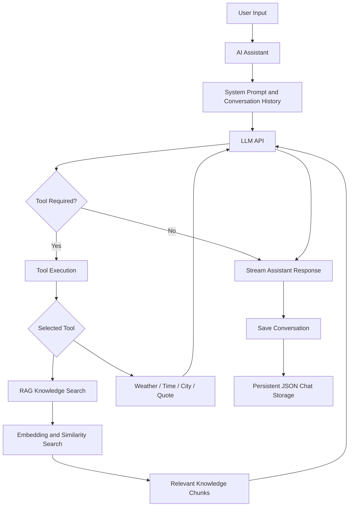

# 🤖 AI Assistant with RAG Pipeline

An intelligent, tool-enabled AI assistant built with Python that combines Large Language Models (LLMs), Retrieval-Augmented Generation (RAG), persistent conversational memory, and function calling to provide context-aware and useful responses.

The assistant can answer general questions, retrieve information from a custom knowledge base, use external tools, and maintain conversations across sessions.

## ✨ Key Features

### 1. Retrieval-Augmented Generation (RAG)
- Loads documents from a customizable knowledge-base directory.
- Splits documents into smaller paragraph-based chunks.
- Generates vector embeddings using a configurable embedding model.
- Stores embedded chunks in a persistent JSON vector store.
- Uses cosine similarity to identify relevant information.
- Retrieves the top relevant chunks to provide context-grounded responses.
- Includes source filenames and chunk identifiers in retrieved context.

### 2. Persistent Conversational Memory
- Automatically saves chat conversations in JSON format.
- Maintains conversation history across application sessions.
- Allows users to view previously saved conversations.
- Resume an existing conversation from where it was left.
- Start a new conversation without deleting previous chats.
- Stores conversation titles, timestamps, and message history.

### 3. Intelligent Tool Calling
The assistant can dynamically invoke tools based on the user's query.

Currently implemented tools:

| Tool | Functionality |
|---|---|
| Current Time | Retrieves the current date and time |
| City Weather | Fetches weather information for a specified city |
| User City | Retrieves the configured user city |
| Random Quote | Fetches an inspirational quote |
| Knowledge Base Search | Retrieves relevant information from the RAG pipeline |

### 4. Prompt Engineering
- Uses a configurable system-level instruction to guide assistant behavior.
- Defines rules for answering general and knowledge-base-specific questions.
- Enforces knowledge-base retrieval for designated company-related queries.
- Restricts answers to retrieved context for company-specific information.
- Provides source references for knowledge-base responses.
- Applies response-length constraints.

### 5. Streaming Responses
- Generates responses incrementally instead of waiting for the entire answer.
- Provides a more interactive command-line experience.
- Handles streamed content and function-call information.

### 6. Chained Tool Execution
- Supports multiple tool calls during a single user interaction.
- Processes tool results and passes them back to the LLM.
- Allows the model to use the results of previous tool executions.
- Implements a maximum of five model interaction rounds per query to prevent excessive execution.

### 7. Logging and Debugging
- Includes a configurable logging utility.
- Supports debug-mode logging through environment variables.
- Provides visibility into tool execution and knowledge-base retrieval.

---

## 🏗️ System Architecture

The application follows a modular architecture in which the main assistant coordinates LLM interactions, RAG retrieval, tool execution, and persistent memory.



## 🔍 RAG Pipeline Workflow

The Retrieval-Augmented Generation pipeline allows the assistant to retrieve relevant information from locally stored text documents before generating answers.

**Step 1: Document Loading**

The application reads `.txt` files from the configured knowledge-base directory.

**Step 2: Document Chunking**

Each document is divided into smaller sections using paragraph separation. Each chunk maintains its source filename and chunk identifier.

**Step 3: Embedding Generation**

An embedding model converts each text chunk into a numerical vector representation.

**Step 4: Vector Storage**

The generated embeddings and their associated text are saved in a JSON-based vector store for reuse.

**Step 5: Similarity Search**

When a user asks a question:
- The query is converted into an embedding.
- Cosine similarity is calculated between the query vector and stored chunk vectors.
- The most relevant chunks are ranked by similarity.
- The top relevant results are returned.

**Step 6: Context-Aware Response Generation**

The retrieved passages are provided to the LLM as context, allowing it to generate responses grounded in the available knowledge base.

## 🧠 Persistent Chat Memory Workflow

The assistant maintains conversations using JSON-based file storage.

Each conversation stores:
- Conversation title
- Last updated timestamp
- Complete message history

The memory module provides three primary operations:

- `save_chat()` – Saves or updates a conversation.
- `load_chat()` – Loads an existing conversation.
- `list_chats()` – Lists saved conversations in descending order of their last update time.

Users can interact with the memory system through the following commands:

| Command | Description |
|---|---|
| `/new` | Starts a new conversation |
| `/chats` | Displays previously saved conversations |
| `/resume` | Allows the user to select and resume a saved conversation |
| `exit` / `quit` / `bye` | Exits the assistant |

---

## 🛠️ Technology Stack

| Technology | Purpose |
|---|---|
| Python | Core application development |
| OpenAI Python SDK | LLM and embedding API integration |
| Large Language Models | Natural language understanding and response generation |
| Embeddings | Numerical representation of text |
| NumPy | Vector operations and cosine similarity |
| JSON | Persistent vector storage and chat history |
| python-dotenv | Environment variable management |
| Requests | External API requests |
| wttr.in | Weather information |
| ZenQuotes API | Random inspirational quotes |

## 📁 Project Structure

```text
AI-assistant-with-RAG-Pipeline/
│
├── Utilities/
│   └── utilities.py
│
├── knowledge_base/
│   └── *.txt
│
├── simple_ai_assistant.py
├── rag.py
├── memory.py
├── tools.py
├── .gitignore
├── .env.example
├── requirements.txt
└── README.md
```

**Module Overview**

| File | Responsibility |
|---|---|
| `simple_ai_assistant.py` | Main application, LLM communication, streaming, prompt handling, and conversation management |
| `rag.py` | Document loading, chunking, embedding generation, vector storage, and similarity search |
| `memory.py` | Persistent chat storage and retrieval |
| `tools.py` | Tool definitions, function execution, and knowledge-base search |
| `Utilities/utilities.py` | Configurable debug logging |
| `knowledge_base/` | Stores source text documents used by the RAG pipeline |

*Note: The structure above includes recommended configuration and documentation files (`.env.example` and `requirements.txt`) that you should add if they are not already present.*

---

## ⚙️ Installation and Setup

### Prerequisites

- Python installed on your system.
- Git.
- An API key for an OpenAI-compatible LLM and embedding provider.
- Access to the configured LLM and embedding models.

### 1. Clone the Repository

```bash
git clone https://github.com/lakshay-png/AI-assistant-with-RAG-Pipeline.git
```

### 2. Navigate to the Project Directory

```bash
cd AI-assistant-with-RAG-Pipeline
```

### 3. Create a Virtual Environment

```bash
python3 -m venv venv
```

Activate it:

**macOS / Linux**

```bash
source venv/bin/activate
```

**Windows**

```bash
venv\Scripts\activate
```

### 4. Install Dependencies

Install the required packages:

```bash
pip install openai python-dotenv numpy requests
```

### 5. Configure Environment Variables

Create a `.env` file in the root directory.

Add the following configuration:

```env
# LLM API Configuration
BASE_URL=your_api_base_url
API_KEY=your_api_key
MODEL=your_chat_model

# Embedding Configuration
EMBED_MODEL=your_embedding_model

# RAG Configuration
KB_FOLDER=knowledge_base
VECTOR_STORE_FILE=knowledge_base/vector_store.json

# Chat Memory Configuration
CHAT_FOLDER=chats

# Debug Configuration
DEBUG=False
```

Replace the placeholder values with your actual API configuration.

**Important:** Keep your `.env` file private. Never upload API keys or other credentials to GitHub.

### 6. Add Knowledge-Base Documents

Place your text documents inside the `knowledge_base/` directory.

Example:

```text
knowledge_base/
├── company_policies.txt
├── technical_documentation.txt
└── frequently_asked_questions.txt
```

These are example filenames. Add your own `.txt` documents.

### 7. Run the Application

```bash
python simple_ai_assistant.py
```

The assistant will initialize the configured API client, load the knowledge base and start the interactive chat session.

---

## 💡 Example Use Cases

**General Questions**

Ask programming, technical, science, or general knowledge questions.

**Knowledge-Base Queries**

Ask questions about information contained in your uploaded knowledge-base documents.

**Weather Information**

Request weather information for a specific city.

**Time and Date**

Ask the assistant for the current date and time.

**Conversation Continuity**

Exit the application and resume an earlier conversation during the next session.

**Multiple Tool Interactions**

Allow the assistant to select and execute appropriate tools based on the user's request.

---

## 🔐 Security and Configuration

- Store API credentials in environment variables.
- Keep `.env` excluded from version control.
- Configure the LLM and embedding endpoints through environment variables.
- Use only trusted knowledge-base documents.
- Review external API requirements and usage limits.

## 🚀 Future Enhancements

Potential improvements for future versions include:

- Integrating a dedicated vector database such as FAISS or ChromaDB.
- Implementing a graphical web-based chat interface.
- Supporting PDF, DOCX, and other document formats.
- Adding advanced semantic retrieval and reranking.
- Introducing user authentication and multi-user chat isolation.
- Adding conversation export and deletion functionality.
- Implementing automated tests and API error handling.
- Supporting configurable conversation summarization for long-term memory.

## 👨‍💻 Author

**Lakshay Karwa**

B.Tech – Computer Science and Engineering  
Manipal University Jaipur

GitHub: [@lakshay-png](https://github.com/lakshay-png)

Project Repository: [AI Assistant with RAG Pipeline](https://github.com/lakshay-png/AI-assistant-with-RAG-Pipeline)

---

⭐ If you find this project interesting, feel free to explore the repository and share your feedback.

Contributions, suggestions, and improvements are welcome!